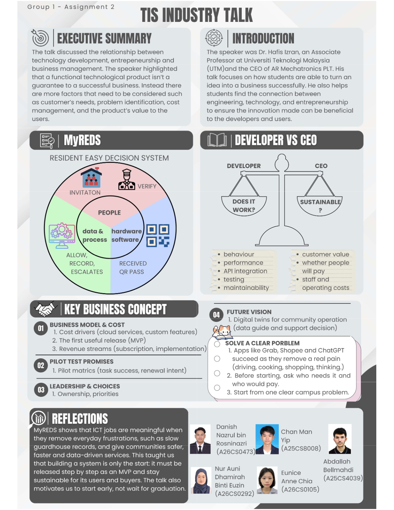

# 🎤 Industry Talk: MyREDS with Dr. Hafis Izran 

**📚 TIS Assignment 2 | 👥 Group 1**

  

---

### 💭 Reflection

I had the chance to attend an Industry Talk by Dr. Hafis Izran on MyREDS. From this talk, I learned that what we study in class can be applied in real projects. Moreover, we need to start now because waiting until graduation to build our skills and experience would put us behind. This talk motivated me to keep improving my skills and to learn more from industry experts.

---
