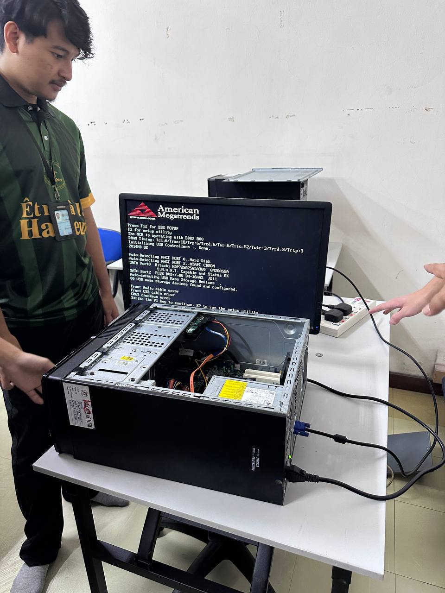
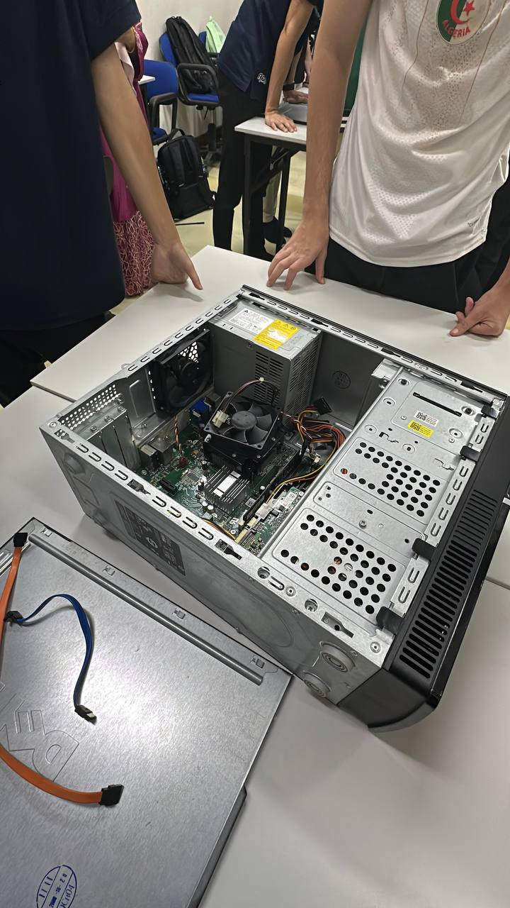
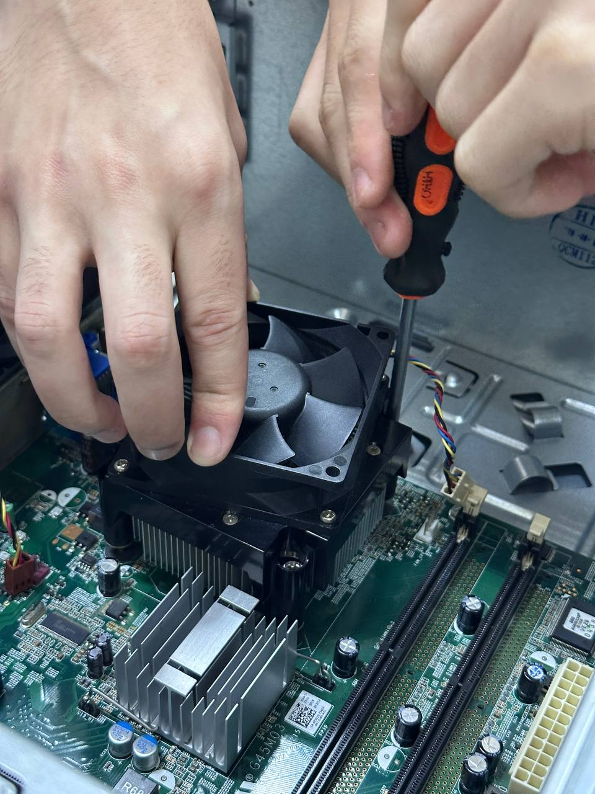
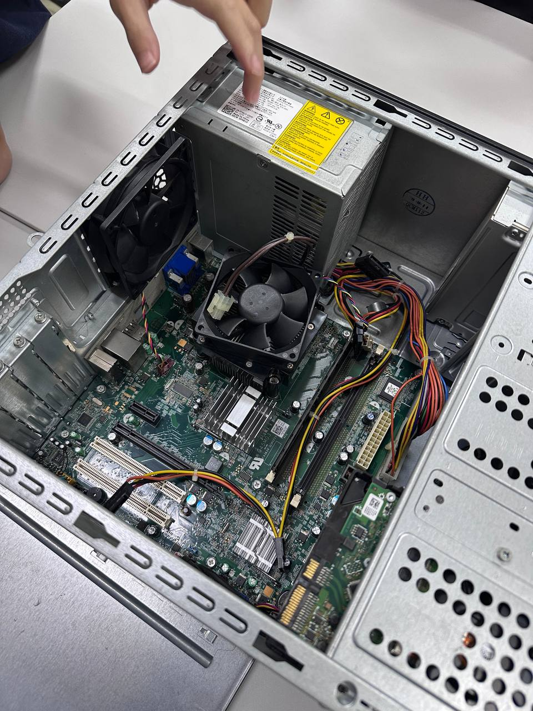

### 🖥️ PC Assembly

  
  

  
  

---

### 📝 Reflection

I had the privilege of learning about PC assembly. In class, I practiced how to disassemble and assemble a PC and discovered what each part does. This class taught me that every part depends on the others for the PC to work. If one part is missing or it is not connected correctly, the whole system will fail to run.

**Course:** Technology and Information System

**Date:** 4 November 2026
